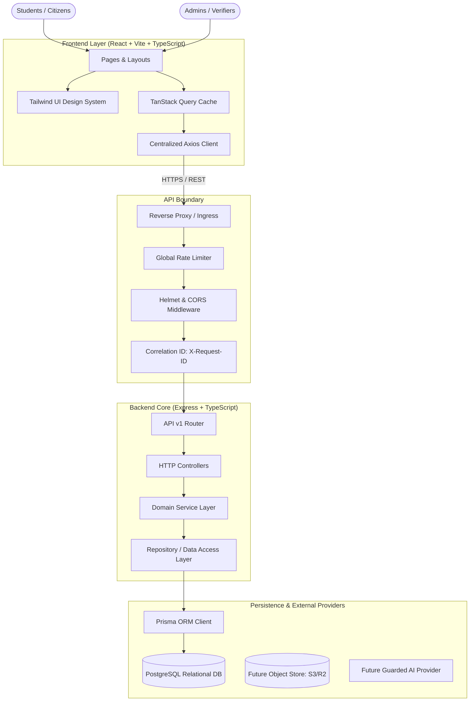

# System Architecture

## Smart Scheme & Scholarship Recommendation Portal

This document outlines the foundation and system architecture established in **Module 1**.

---

## 1. High-Level Modular Monolith Architecture

The application is structured as a **modular monolith** with clean layer boundaries, allowing future extraction into dedicated microservices if scale dictates.



---

## 2. Backend Layered Architecture

To prevent tight coupling, code must flow in a single direction:

```text
Request
  │
  ▼
[Request ID & Logger Middleware]
  │
  ▼
[Zod Request Validation Middleware] (Body, Query, Params)
  │
  ▼
[Controller] (Extracts parameters, sets HTTP status, formats standard envelope)
  │
  ▼
[Service] (Pure business logic, orchestration, zero HTTP imports)
  │
  ▼
[Repository] (Extends BaseRepository, handles Prisma queries & transactions)
  │
  ▼
[Prisma Client / PostgreSQL]
  │
  ▼
Response (Standardized ApiSuccessResponse or ApiErrorResponse)
```

---

## 3. Ten-Module Boundary Map

| Module | Name | Responsibility | Status |
|---|---|---|---|
| **1** | **Foundation & Architecture** | Project setup, Express/React scaffolds, Postgres/Prisma, API standards, Error & logging | **ACTIVE** |
| **2** | **Auth, Roles & User Profiles** | JWT, RBAC, citizen & student profiles, consent records | READY |
| **3** | **Scheme & Scholarship Catalog** | Verified database, departments, eligibility criteria metadata | PLANNED |
| **4** | **Rule-Based Recommendation Engine**| Deterministic tri-state rules (`True/False/Unknown`), explainability | PLANNED |
| **5** | **Discovery & Dashboard** | Faceted filters, recommendation ranking, comparisons | PLANNED |
| **6** | **Documents, OCR & Verification** | Consent-based field detection, confidence scores | PLANNED |
| **7** | **Notifications & Deadlines** | Background queue, deadline alerts, preference settings | PLANNED |
| **8** | **AI Assistant Layer** | Grounded RAG, regional language support, no hallucination | PLANNED |
| **9** | **Administration & Audit** | Scheme verification workflow, audit trails, metrics | PLANNED |
| **10**| **Production & Scale** | CI/CD, containerization, observability | PLANNED |

---

## 4. Error Handling Standard

All backend errors inherit from `AppError` and are mapped to consistent HTTP status codes:

```typescript
{
  "success": false,
  "error": {
    "code": "VALIDATION_ERROR | UNAUTHORIZED | FORBIDDEN | NOT_FOUND | CONFLICT | RATE_LIMITED | INTERNAL_ERROR",
    "message": "Human-readable description",
    "details": [],
    "requestId": "uuid-v4-correlation-id"
  }
}
```

Stack traces and database credentials are strictly suppressed in non-development environments.
